# ⏰ Автоматизация будильников на iPhone по расписанию ДГТУ

Комплекс для автоматической настройки трёх будильников на iPhone в зависимости от времени первой пары в университете (ДГТУ).

---

## 📐 Архитектура (в 5 строк)

1. **GitHub Actions** запускается ночью (02:00 и 02:30 по Москве) и скачивает iCal-календарь ДГТУ по секретной ссылке.
2. Скрипт находит первую пару на сегодня для подгруппы 1, вычисляет оптимальный слот и формирует `public/schedule.json`.
3. Готовый JSON безопасно публикуется через **GitHub Pages** (без ФИО преподавателей, номеров групп и секретных URL).
4. На **iPhone в 04:00** срабатывает быстрая команда iOS: запрашивает свежий JSON и сверяет дату.
5. Команда включает нужный будильник («Пары 07:00», «Пары 08:45» или «Пары 10:00»), выключает остальные и выводит уведомление.

```mermaid
flowchart LR
    A["ДГТУ iCal"] -->|"02:00 / 02:30 MSK (Secret URL)"| B["GitHub Actions"]
    B -->|"Парсинг + Расчёт слота"| C["public/schedule.json"]
    C -->|"Deploy"| D["GitHub Pages"]
    D -->|"04:00 MSK (GET /schedule.json?t=...)"| E["iPhone Быстрые команды"]
    E -->|"Включение слота"| F["Будильники iOS"]
```



---

## ⚙️ Настройки в `config.json`

Параметры хранятся в корневом файле [config.json](file:///Users/ekwsod/Projects/schedule-alarm/config.json):
```json
{
  "subgroup": 1,
  "prep_minutes": 90,
  "latest_alarm": "10:00",
  "slots": ["07:00", "08:45", "10:00"],
  "timezone": "Europe/Moscow"
}
```

* **subgroup**: номер вашей подгруппы (по умолчанию 1). Пары без пометки «п/г» считаются общими и также учитываются.
* **prep_minutes**: сколько минут нужно на подъём, сборы и дорогу до первой пары (по умолчанию 90 мин).
* **latest_alarm**: предельное время будильника (10:00). Если пара начинается в 12:00 или позже, будильник не ставится позже 10:00.
* **slots**: доступные фиксированные будильники, созданные на iPhone.
* **timezone**: `Europe/Moscow` (UTC+3, без перехода на сезонное время).
* **exclude_keywords**: список исключаемых дисциплин (по умолчанию: `["русский язык как иностранный", "русский как иностранный", "рки"]`). Если пара содержит любое из этих слов, она игнорируется при расчёте будильника (например, занятия РКИ для иностранных студентов).

### Логика расчёта слота
$$\text{target} = \min(\text{время первой пары} - \text{prep\_minutes}, \text{latest\_alarm})$$
Выбирается **самый поздний** слот из списка `slots`, который $\le \text{target}$.
* 08:30 $\rightarrow$ расчет: 07:00 $\rightarrow$ слот: `07:00`
* 10:15 $\rightarrow$ расчет: 08:45 $\rightarrow$ слот: `08:45`
* 12:00 $\rightarrow$ расчет: $\min(10:30, 10:00) = 10:00 \rightarrow$ слот: `10:00`
* 14:15, 16:00 и позже $\rightarrow$ слот: `10:00`
* 09:00 $\rightarrow$ расчет: 07:30 $\rightarrow$ слот: `07:00`
* 08:00 $\rightarrow$ расчет: 06:30 $\rightarrow$ нет слота $\le 06:30 \rightarrow$ слот: `07:00` с предупреждением в поле `warning`
* Если пар нет (выходной, каникулы) $\rightarrow$ слот: `null`, все три будильника отключаются.

---

## 🚀 Настройка на GitHub (что сделать руками)

1. **Проверить секрет репозитория**:
   * Перейдите в **Settings** $\rightarrow$ **Secrets and variables** $\rightarrow$ **Actions**.
   * Убедитесь, что добавлен секрет с именем `DONSTU_ICAL_URL` со ссылкой на iCal-календарь.

2. **Включить публикацию через GitHub Pages**:
   * Перейдите в **Settings** $\rightarrow$ **Pages**.
   * В блоке **Build and deployment**:
     * **Source**: выберите **GitHub Actions**.

3. **Разрешить запись для Actions (нужно для keepalive)**:
   * Перейдите в **Settings** $\rightarrow$ **Actions** $\rightarrow$ **General**.
   * В разделе **Workflow permissions** выберите **Read and write permissions** и нажмите **Save**.

4. **Первый запуск и проверка**:
   * Перейдите на вкладку **Actions**.
   * Выберите рабочий процесс **Schedule Alarm Pages** и нажмите кнопку **Run workflow** $\rightarrow$ **Branch: main**.
   * После завершения перейдите по адресу:
     `https://<ваш_логин>.github.io/<имя_репозитория>/schedule.json`
     *(например, `https://ekwsod.github.io/schedule-alarm/schedule.json`)*.
   * Убедитесь, что возвращается корректный JSON с сегодняшней датой в `for_date`.

---

## 📱 Пошаговая настройка на iPhone (iOS 17 / iOS 18)

### Шаг 1. Создать три базовых будильника
В стандартном приложении **Часы** $\rightarrow$ вкладка **Будильники** создайте 3 будильника с точными названиями:
1. Время: `07:00`, Название: `Пары 07:00`, Повтор: каждый день.
2. Время: `08:45`, Название: `Пары 08:45`, Повтор: каждый день.
3. Время: `10:00`, Название: `Пары 10:00`, Повтор: каждый день.
*(Изначально их можно оставить выключенными — автоматизация включит нужный).*

---

### Шаг 2. Создать быструю команду (Shortcuts)
Откройте приложение **Команды** (Shortcuts) и создайте новую команду с названием **«Синхронизация будильника пар»**:

1. **Добавить действие «Текст»**:
   * Введите адрес вашего JSON с параметром защиты от кэширования:
     `https://ekwsod.github.io/schedule-alarm/schedule.json?t=`
   * Сразу после `=` нажмите на виртуальной клавиатуре на переменную **Текущая дата**.
   * Нажмите на вставленную дату и задайте формат: *Настраиваемый* $\rightarrow$ `yyyyMMddHHmmss`.

2. **Добавить действие «Получить содержимое URL»**:
   * Передайте текст из шага 1 (метод GET).

3. **Добавить действие «Получить значение из словаря»**:
   * Ключ: `for_date`
   * Словарь: *Содержимое URL*.

4. **Добавить действие «Форматировать дату»**:
   * Дата: **Текущая дата**
   * Формат даты: *Настраиваемый* $\rightarrow$ `yyyy-MM-dd`.

5. **Добавить условие «Если»**:
   * Если `Значение из словаря` (for_date) **не совпадает** с `Форматированная дата`:
     * Добавить действие: **Показать уведомление** $\rightarrow$ текст: `⚠️ Расписание не обновилось! Будильники не изменены.`
     * Добавить действие: **Остановить эту быструю команду**.
   * **Конец условия**.

6. **Добавить действие «Получить значение из словаря»**:
   * Ключ: `alarm_slot`
   * Словарь: *Содержимое URL*.

7. **Настройка переключения будильников (ветвление)**:
   * **Если** `alarm_slot` **совпадает с** `07:00`:
     * Действие «Переключить будильник»: будильник **Пары 07:00** $\rightarrow$ режим **Включить**.
     * Действие «Переключить будильник»: будильник **Пары 08:45** $\rightarrow$ режим **Выключить**.
     * Действие «Переключить будильник»: будильник **Пары 10:00** $\rightarrow$ режим **Выключить**.
   * **Иначе если** `alarm_slot` **совпадает с** `08:45`:
     * Действие «Переключить будильник»: будильник **Пары 07:00** $\rightarrow$ режим **Выключить**.
     * Действие «Переключить будильник»: будильник **Пары 08:45** $\rightarrow$ режим **Включить**.
     * Действие «Переключить будильник»: будильник **Пары 10:00** $\rightarrow$ режим **Выключить**.
   * **Иначе если** `alarm_slot` **совпадает с** `10:00`:
     * Действие «Переключить будильник»: будильник **Пары 07:00** $\rightarrow$ режим **Выключить**.
     * Действие «Переключить будильник»: будильник **Пары 08:45** $\rightarrow$ режим **Выключить**.
     * Действие «Переключить будильник»: будильник **Пары 10:00** $\rightarrow$ режим **Включить**.
   * **Иначе** *(пар нет или alarm_slot равен null)*:
     * Действие «Переключить будильник»: будильник **Пары 07:00** $\rightarrow$ режим **Выключить**.
     * Действие «Переключить будильник»: будильник **Пары 08:45** $\rightarrow$ режим **Выключить**.
     * Действие «Переключить будильник»: будильник **Пары 10:00** $\rightarrow$ режим **Выключить**.
   * **Конец условия**.

8. **Вывод уведомления пользователю**:
   * Добавить действие «Получить значение из словаря»: ключ `notification`.
   * Добавить действие **«Показать уведомление»**:
     * Текст: `[Значение из словаря (notification)]`
     * Заголовок: `Расписание ДГТУ`

---

### Шаг 3. Создать автоматизацию по времени
1. В приложении **Команды** перейдите во вкладку **Автоматизация** $\rightarrow$ **Новая автоматизация** (+).
2. Выберите **Время суток** $\rightarrow$ укажите `04:00`, Повторять: **Ежедневно**.
3. Обязательно выберите: **Запускать немедленно** (Run Immediately).
4. Отключите тумблер: **Уведомлять при запуске** (Notify When Run) $\rightarrow$ Выключено.
5. На следующем шаге выберите вашу команду **«Синхронизация будильника пар»**.

---

## 🛠️ Файлы GitHub Actions

В папке `.github/workflows/` должны находиться два workflow-файла:

### 1. `.github/workflows/schedule.yml`
```yaml
name: Schedule Alarm Pages

on:
  schedule:
    # 23:00 UTC = 02:00 по Москве (UTC+3)
    - cron: '0 23 * * *'
    # 23:30 UTC = 02:30 по Москве (UTC+3) — повторный запуск для надежности
    - cron: '30 23 * * *'
  workflow_dispatch:

concurrency:
  group: 'pages'
  cancel-in-progress: false

permissions:
  contents: read
  pages: write
  id-token: write

jobs:
  build:
    runs-on: ubuntu-latest
    steps:
      - name: Checkout repository
        uses: actions/checkout@v4

      - name: Set up Python 3.12
        uses: actions/setup-python@v5
        with:
          python-version: '3.12'

      - name: Run unit and integration tests
        run: |
          python -m unittest discover -s tests -v

      - name: Fetch schedule and generate JSON
        env:
          DONSTU_ICAL_URL: ${{ secrets.DONSTU_ICAL_URL }}
        run: |
          python schedule_alarm.py

      - name: Upload GitHub Pages artifact
        uses: actions/upload-pages-artifact@v3
        with:
          path: public/

  deploy:
    needs: build
    runs-on: ubuntu-latest
    environment:
      name: github-pages
      url: ${{ steps.deployment.outputs.page_url }}
    steps:
      - name: Deploy to GitHub Pages
        id: deployment
        uses: actions/deploy-pages@v4
```

### 2. `.github/workflows/keepalive.yml`
```yaml
name: Keepalive Workflow

on:
  schedule:
    # Запуск 1-го числа каждого месяца в 00:00 UTC
    - cron: '0 0 1 * *'
  workflow_dispatch:

permissions:
  contents: write

jobs:
  keepalive:
    runs-on: ubuntu-latest
    steps:
      - uses: actions/checkout@v4
      - uses: gautamkrishnar/keepalive-workflow@v2
```

---

## 🔍 Предотвращение отключения через 60 дней (Keepalive)

### Политика GitHub
В публичных репозиториях GitHub автоматически **отключает запуск workflow по расписанию (cron)**, если в репозитории не было активности в течение **60 дней** (не было коммитов, PR, создания issues или ручных запусков).

### Выбранное решение
Мы используем официальный `gautamkrishnar/keepalive-workflow@v2`, запускаемый раз в месяц по расписанию. Если за последние 40–50 дней в репозитории не было коммитов, он автоматически выполняет пустой коммит в служебную ветку через стандартный `GITHUB_TOKEN`.

### Плюсы и минусы решения
* **Плюсы**:
  * Полная автономность: расписание и будильники никогда не перестанут работать неожиданно посреди семестра.
  * Не требует сторонних серверов или cron-сервисов.
* **Минусы**:
  * Требует включения права `Read and write permissions` в настройках репозитория (*Settings $\rightarrow$ Actions $\rightarrow$ General $\rightarrow$ Workflow permissions*).
  * Периодически (раз в полтора месяца) создаёт автоматический технический коммит.
* **Альтернатива без прав на запись**: раз в 50 дней вручную нажимать кнопку «Run workflow» во вкладке Actions либо перевключать workflow по ссылке из уведомительного письма от GitHub.

---

## 🚨 Если что-то сломалось

1. **Расписание на телефоне не обновилось**:
   * Айфон проверяет поле `for_date`. Если оно не равно сегодняшней дате, команда выдаст предупреждение и **не станет менять будильники**.
   * Проверьте вкладку **Actions** на GitHub: возможно, ночной запуск завершился ошибкой (например, портал ДГТУ был временно недоступен).
   * Нажмите **Run workflow** вручную.

2. **GitHub отключил cron-расписание**:
   * Если workflow был отключен из-за неактивности, перейдите в **Actions** $\rightarrow$ **Schedule Alarm Pages** $\rightarrow$ нажмите **Enable workflow**.

3. **Сайт ДГТУ блокирует запросы из облака GitHub Actions**:
   * Если сайт ДГТУ включит строгую блокировку зарубежных IP или защиту Cloudflare / GeoIP:
     * В workflow запуск скрипта завершится с ошибкой сети.
     * Благодаря механизму защиты старый файл `schedule.json` **не будет перезаписан пустым**, а деплой отменится.
     * Запасной сценарий: можно запускать `schedule_alarm.py` на локальном домашнем компьютере/Raspberry Pi или настроить Быструю команду на iPhone для прямого парсинга iCal с телефона (так как с мобильного интернета РФ доступ к ДГТУ всегда открыт).
