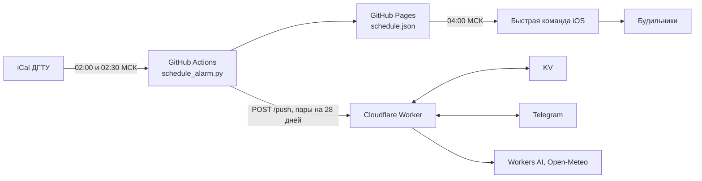

# Будильники по расписанию ДГТУ

[](https://github.com/ekwsod/DONSTU_ICAL_URL/actions/workflows/ci.yml)

Личная автоматизация вокруг расписания ДГТУ:

- **Будильники на iPhone.** Каждую ночь GitHub Actions скачивает iCal-календарь, находит первую пару на день и публикует на GitHub Pages небольшой `schedule.json`. В 04:00 быстрая команда iOS забирает его и включает один из трёх будильников (07:00, 08:45 или 10:00) либо выключает все, если пар нет.
- **Telegram-бот.** Cloudflare Worker показывает расписание по дням и неделям с погодой, присылает план дня перед выходом, хранит домашние задания и напоминает о них. Пары получает от того же ночного запуска.

## Как это устроено



Ссылка на календарь хранится только в секрете репозитория. На Pages попадают время первой пары, выбранный слот и очищенное название предмета; полный список пар уходит только боту.

## Структура

| Путь | Что это |
|---|---|
| `schedule_alarm.py` | загрузка и разбор iCal, расчёт будильника, отправка пар боту |
| `config.json` | подгруппа, время на сборы, слоты будильников, исключённые предметы |
| `tests/` | тесты скрипта (`unittest`) |
| `bot/` | Telegram-бот: TypeScript, grammY, Cloudflare Workers |
| `.github/workflows/schedule.yml` | ночной расчёт и деплой на Pages |
| `.github/workflows/keepalive.yml` | ежемесячно включает расписание заново, чтобы GitHub его не отключил |
| `.github/workflows/ci.yml` | тесты на каждый push и pull request |
| `.claude/agents/` | описания агентов Claude Code, которые помогают вести проект |

## Тесты

```bash
python3 -m unittest discover -s tests -v

cd bot
npm ci
npx tsc --noEmit
npx vitest run
```

Для бота нужен Node.js 22.12 или новее.

## Документация

- [docs/setup.md](docs/setup.md) — настройка репозитория, секреты, `config.json`, расчёт слота, keepalive, что делать при сбоях.
- [docs/iphone.md](docs/iphone.md) — будильники и быстрая команда на iPhone.
- [bot/README.md](bot/README.md) — Telegram-бот: возможности, архитектура, деплой.
